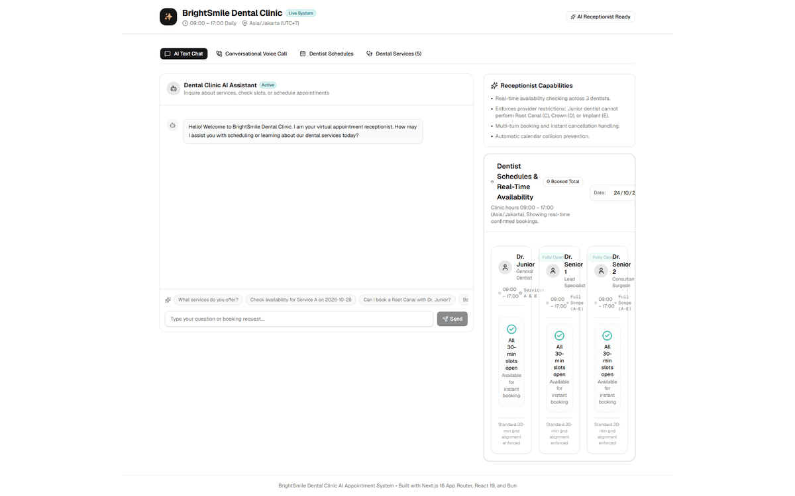
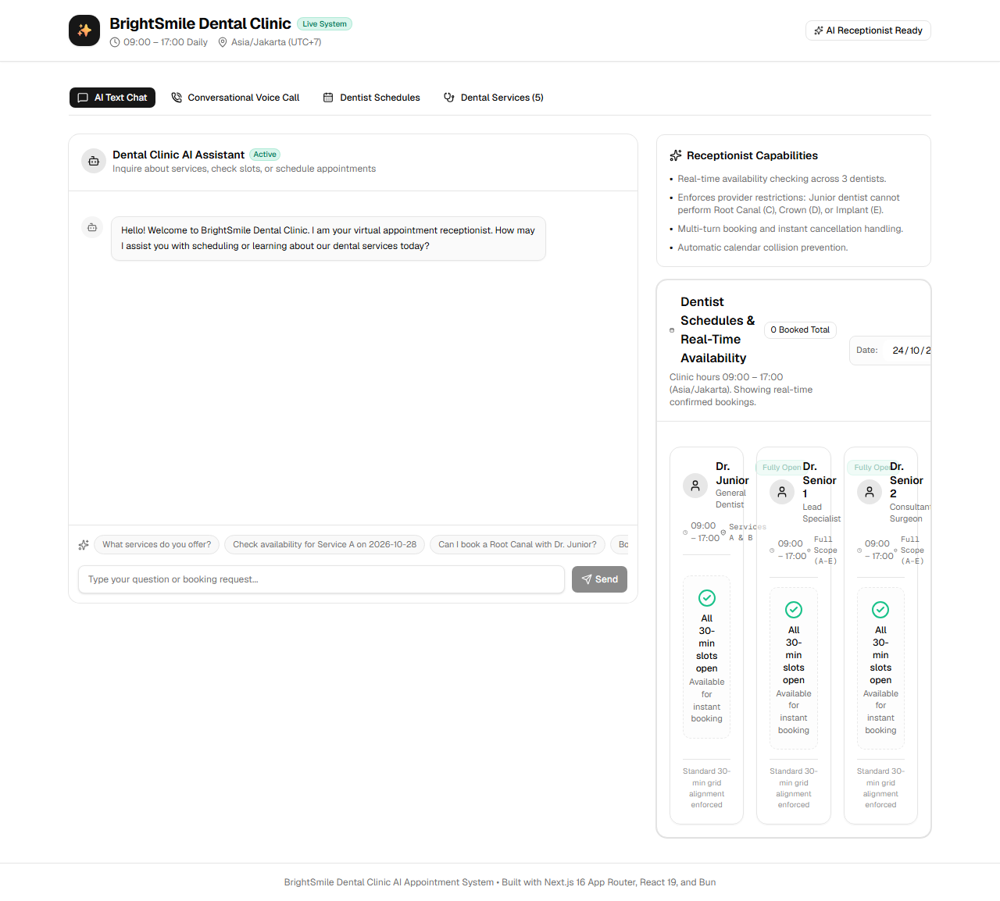
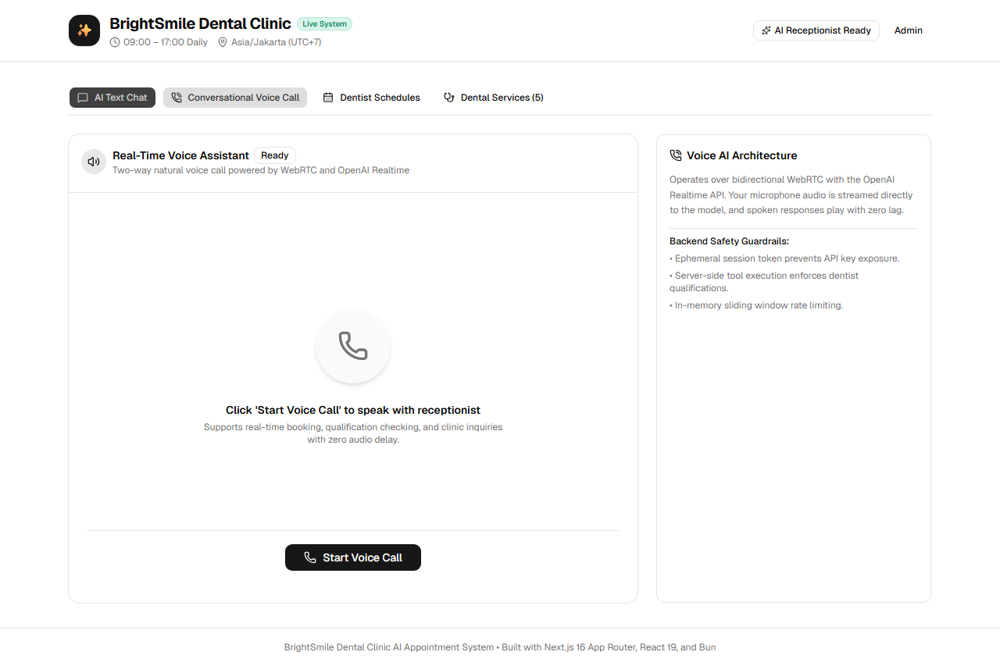
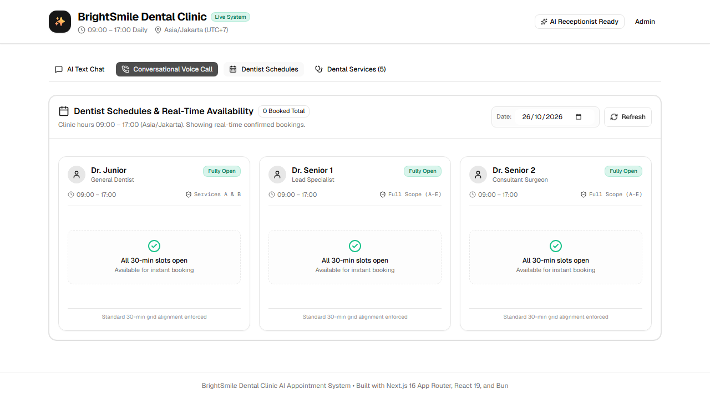
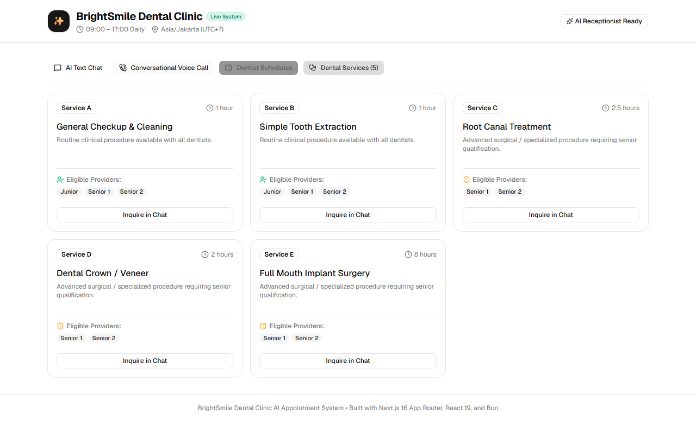

# 🦷 BrightSmile Dental Clinic — Conversational AI Appointment System

[](https://bun.sh)
[](https://nextjs.org)
[](https://react.dev)
[](https://tailwindcss.com)
[](https://www.typescriptlang.org)
[](https://playwright.dev)

A modern, production-grade conversational AI assistant designed for dental clinics. Enables patients to check availability, schedule appointments, and inquire about treatments using **two-way real-time voice calls (WebRTC)** and **interactive text chat**, backed by **authoritative dentist qualification rules** and **bidirectional calendar sync** with both **Google Calendar** and **Microsoft Outlook**.

---

## 🎬 Live Interactive Preview



---

## 📸 Interface Screenshots

| 💬 AI Text Chat | 🎙️ WebRTC Voice Assistant |
| :---: | :---: |
|  |  |
| **📅 Dentist Live Schedules** | **🩺 Services Catalog & Qualifications** |
|  |  |

---

## 📋 Core Clinical Rules & Doctor Qualifications

The clinic operates daily from **09:00 to 17:00 (Asia/Jakarta / UTC+7)**. The system enforces strict provider qualification constraints:

| Code | Service Name | Duration | Eligible Dentists | Clinical Constraints |
| :--- | :--- | :--- | :--- | :--- |
| **Service A** | General Checkup & Cleaning | 1.0 Hour (60 min) | Dr. Junior, Dr. Senior 1, Dr. Senior 2 | Open to all providers |
| **Service B** | Simple Tooth Extraction | 1.0 Hour (60 min) | Dr. Junior, Dr. Senior 1, Dr. Senior 2 | Open to all providers |
| **Service C** | Root Canal Treatment | 2.5 Hours (150 min) | Dr. Senior 1, Dr. Senior 2 | **Specialists only** (Junior strictly prohibited) |
| **Service D** | Dental Crown / Veneer | 2.0 Hours (120 min) | Dr. Senior 1, Dr. Senior 2 | **Specialists only** (Junior strictly prohibited) |
| **Service E** | Full Mouth Implant Surgery | 6.0 Hours (360 min) | Dr. Senior 1, Dr. Senior 2 | **Requires 6 continuous hours** with a Senior Specialist |

> 🛡️ **Authoritative Server Enforcement:** Clinical qualification checks are executed in the core backend domain service (`AppointmentService`). Even if a user attempts prompt injection or an LLM requests Dr. Junior for Service C/D/E, the server immediately rejects the request.

---

## 🏗️ Architecture & Technology Stack

```
dental-ai-bot/
├── src/
│   ├── app/                      # Next.js 16 App Router pages & API route handlers
│   │   ├── page.tsx              # Unified clinical portal (Chat, Voice, Matrix, Services)
│   │   └── api/v1/
│   │       ├── chat/             # Guarded text chat delivery with rate limiter
│   │       ├── voice/session/    # Ephemeral WebRTC session token gate
│   │       ├── voice/tools/      # Authoritative tool execution for voice events
│   │       └── appointments/     # Daily schedule query & direct booking API
│   ├── components/               # UI components (ChatWidget, VoiceWidget, SchedulePreview)
│   ├── domain/                   # Pure business logic (Dentists, Services, Scheduling engine)
│   ├── features/voice/           # WebRTC client engine & React hook (VoiceSessionManager)
│   ├── providers/
│   │   ├── ai/                   # Provider-neutral LLM contract & OpenAI adapter
│   │   ├── calendar/             # Provider-neutral Calendar contract, Google & Outlook adapters
│   │   └── voice/                # Ephemeral token voice provider contract & Realtime adapter
│   ├── repository/               # PostgreSQL persistence (Drizzle ORM) + In-Memory repository
│   ├── safety/                   # Prompt injection defense, medical deflection & rate limiter
│   └── services/                 # Chat orchestrator, AppointmentService & tool definitions
├── e2e/                          # Playwright end-to-end tests
├── tests/                        # Bun unit, integration, and contract test suites
└── docs/                         # Architecture, cost model, and client documentation
```

### Key Highlights:
1. **Zero Client Secret Leakage:** Master API keys (`OPENAI_API_KEY`) never reach client browsers. Voice calls authenticate using ephemeral tokens issued by `/api/v1/voice/session` with under 60-second validity.
2. **Dual-Calendar Parity:** Unified `CalendarProvider` contract synchronizes bookings with **Google Calendar (API v3)** and **Microsoft Outlook (Microsoft Graph)** with canonical RFC3339 UTC timestamps.
3. **Enterprise Safety & Guardrails:** 
   - `sanitizeUserInput`: Intercepts prompt injections (`DAN`, `ignore previous instructions`, `leak system prompt`).
   - Medical Advice Deflection: Automatically deflects medical diagnosis and prescription requests with clinical disclaimers before LLM token consumption.
   - `SlidingWindowRateLimiter`: In-memory IP-based rate limiting guarding API endpoints against quota abuse.
4. **PostgreSQL & Drizzle ORM:** Booking reservations are guarded by a PostgreSQL
   transaction-scoped advisory lock per dentist/date plus an overlap check, so two concurrent
   requests cannot both reserve an overlapping slot. Includes an offline
   `InMemoryAppointmentRepository` for zero-dependency CI testing.

---

## 🚀 Quickstart Guide

### Prerequisites
- **Bun**: `>= 1.4.3` (installed: `bun@1.4.4`)
- Node.js environment (for optional Playwright browser execution)

### 1. Installation

```bash
# Clone the repository
git clone https://github.com/wafik/dental-ai-bot.git
cd dental-ai-bot

# Install dependencies using Bun
bun install
```

### 2. Environment Setup

Create a `.env.local` file by copying the template:

```bash
cp .env.example .env.local
```

Configure your API keys as needed (mock adapters run out-of-the-box for offline testing):
```env
OPENAI_API_KEY="sk-proj-your-openai-api-key"
CLINIC_TIMEZONE="Asia/Jakarta"
CALENDAR_PROVIDER="both" # or "none" for local-only mode
KOKORO_TTS_BASE_URL="http://localhost:8880/v1"
KOKORO_TTS_VOICE="af_heart"
```

Every booking is written to **both** Google Calendar and Outlook. Calendar resolution is
fail-closed: with `CALENDAR_PROVIDER="both"` (the default), a missing provider credential block or a
missing per-dentist calendar ID makes the app throw instead of silently skipping a calendar. Use
`CALENDAR_PROVIDER="none"` only for local development without external calendars.

If a provider write fails, the appointment stays `pending`, its slot stays blocked, and the
per-provider work is recorded for retry. Point an external scheduler at
`POST /api/v1/admin/reconcile-calendar` with the `CALENDAR_RECONCILE_TOKEN` bearer token to drain
retries with backoff; see [docs/CALENDAR_SETUP.md](docs/CALENDAR_SETUP.md#6-retrying-failed-writes).

Text chat reads new assistant replies aloud by default. Patients can turn **Auto-read** off in the
chat header or use a reply's **Read aloud** button. Text-to-speech uses a separately deployed
Kokoro-FastAPI service exposing the OpenAI-compatible `POST /v1/audio/speech` endpoint. The URL is
used by the Next.js server and must be reachable from that server, not from the patient's browser.
When Kokoro is unavailable, chat replies still appear and can be retried later; generated audio is
not stored by the app. See the [clinic guide](docs/EXTERNAL_CLIENT_GUIDE.md#optional-kokoro-text-to-speech-service)
for setup details.

### 2b. Admin Console Setup (production)

Provider credentials can be managed from `/admin` instead of environment variables.
Generate the deployment secrets once and keep them outside the repository:

```bash
bun run hash:admin-password "choose-a-strong-password"   # -> ADMIN_PASSWORD_HASH
node -e "console.log(require('crypto').randomBytes(32).toString('hex'))"  # SETTINGS_ENCRYPTION_KEY
bun run db:migrate
```

Then open [http://localhost:3000/admin](http://localhost:3000/admin). Stored credentials are
write-only: the API returns only configured status, and the eye toggle reveals only the value
currently being typed. Environment variables remain a bootstrap fallback for any credential not
entered in the admin console.

For Google Calendar, either paste the **Service Account Email** and **Service Account Private Key**
from your key JSON, or the delegated Client ID / Client Secret / Refresh Token. Service-account auth
takes precedence when both are present. A service account only sees calendars explicitly shared with
its email, so share each dentist calendar with it first.

To bootstrap the service-account credentials from a key file instead of the UI:

```bash
bun run import:google-service-account path/to/service-account.json
```

### 3. Running Locally

```bash
# Start development server with Turbopack
bun run dev
```

Open [http://localhost:3000](http://localhost:3000) in your browser to experience the clinical portal.

---

## 🧪 Testing & Quality Gates

The project strictly follows the tooling standards pinned in project instructions:

```bash
# 1. Format code (Oxfmt)
bun run format

# 2. Typecheck (Bun check - zero TypeScript errors)
bun run check

# 3. Lint code (Oxlint - zero warnings)
bun run lint

# 4. Unit & Integration Test Suite (181 tests passing in ~200ms)
bun test

# 5. Playwright End-to-End Tests (starts a disposable PostgreSQL container; Docker required)
bun run test:e2e

# 6. Next.js Production Build
bun run build
```

---

## 💰 Production Financial Cost Analysis

A concrete monthly cost model for an active dental clinic handling **1,000 voice calls** (3,000 spoken minutes) and **3,000 chat interactions** (15,000 turns):

| Service Category | Monthly Cost (USD) | Notes |
| :--- | :--- | :--- |
| **Conversational Voice AI (OpenAI Realtime WebRTC)** | $555.00 | 3,000 spoken minutes @ $0.06 in / $0.24 out |
| **Text Chat LLM (GPT-4o-mini)** | $4.05 | 18M input tokens / 2.25M output tokens |
| **Application Hosting (Vercel / AWS ECS)** | $20.00 | Serverless Next.js edge runtime |
| **Managed Database (PostgreSQL / Neon / Supabase)** | $15.00 | Dedicated instance with automated backups |
| **Calendar APIs (Google Cloud & MS Graph)** | $5.00 | Free quotas cover up to 1M queries/day |
| **TOTAL ESTIMATED MONTHLY COST** | **$599.05** | **~$0.56 per voice call / $0.0014 per chat** |

> For comprehensive cost calculations, trade-offs, and HIPAA/GDPR considerations, see [docs/INTERNAL_ARCHITECTURE_AND_COST.md](docs/INTERNAL_ARCHITECTURE_AND_COST.md).

---

## 📚 Project Documentation

* [docs/PLAN.md](docs/PLAN.md) — 7-Day Implementation Roadmap and requirements breakdown.
* [docs/INTERNAL_ARCHITECTURE_AND_COST.md](docs/INTERNAL_ARCHITECTURE_AND_COST.md) — System architecture, Mermaid diagrams, financial analysis, and security decisions.
* [docs/EXTERNAL_CLIENT_GUIDE.md](docs/EXTERNAL_CLIENT_GUIDE.md) — Non-technical practice manager guide, Google/Outlook connection steps, and FAQ.
* [docs/CALENDAR_SETUP.md](docs/CALENDAR_SETUP.md) — Cloud OAuth setup for Google Cloud Platform and Microsoft Entra ID.

---

## ⚖️ License

MIT License. Designed and engineered for BrightSmile Dental Clinic.
