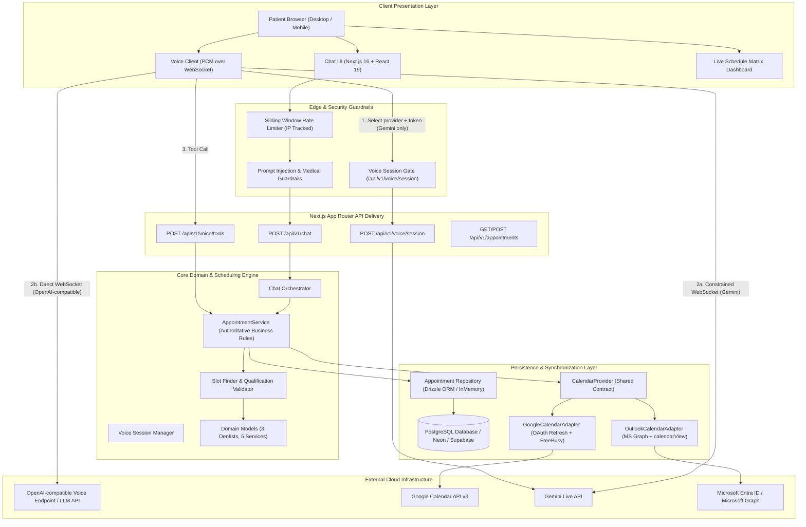

# Internal Architecture, Technical Decisions, and Financial Cost Analysis

**Target Role:** Forward Deployment Engineer — Functional AI Solutions  
**Project:** AI-Driven Dental Appointment Booking System (Voice + Chat + Multi-Calendar)  
**Date:** October 2026  
**Status:** Production-Ready Reference Architecture

---

## 1. Executive Summary & Architecture Overview

The Dental Clinic Conversational AI platform provides an enterprise-grade, omnichannel patient scheduling solution. Patients can book, inquire, reschedule, and verify dental appointments through two-way natural voice calls (streamed over WebSocket) and text chat.

The architecture enforces strict clinical safety guardrails, provider-agnostic modularity, authoritative backend validation, and bidirectional calendar synchronization with both Google Calendar and Microsoft 365 Outlook.

### High-Level System Architecture Diagram

---

## 2. Technical Decisions & Trade-Off Matrix

### 2.1 Provider-Agnostic AI & Voice Integration

* **Decision:** Use provider-neutral LLM and server voice contracts. The browser voice session manager delegates media and protocol handling to a transport; each provider supplies its own server adapter and browser transport, and `DefaultVoiceTransport` picks one by asking the session route which provider is configured.
* **Why:** A different voice provider requires its own server and browser adapters and explicit composition, without changing the generic session manager or clinical scheduling logic. Two voice providers are implemented: Gemini Live (server-minted ephemeral token over a constrained WebSocket) and any OpenAI Realtime GA-compatible endpoint (selected with `OPENAI_COMPATIBLE_VOICE_URL` when `GEMINI_API_KEY` is unset). No new dependency is needed for either: both are plain WebSocket + PCM.
* **Security Guard:** Never expose master API keys to client browsers. With Gemini the server returns a single-use ephemeral token; with an OpenAI-compatible endpoint there is no credential to hand out, so instead the **role and tools still come from the server** in the session descriptor and the browser applies them verbatim. Either way the client cannot widen the assistant's scope or reach tools the clinic did not grant.

### 2.2 Dual-Calendar Parity (Google Calendar + Microsoft Outlook)

* **Decision:** Design a unified `CalendarProvider` interface with RFC3339 UTC normalization (`YYYY-MM-DDTHH:mm:ssZ`).
* **Why:** Clinics run heterogeneous software stacks. Private practices commonly use Google Workspace, whereas hospital-affiliated clinics standardize on Microsoft 365 / Entra ID.
* **Implementation Highlights:**
  * **Google Calendar:** Uses OAuth 2.0 refresh token rotation, in-memory bearer token caching with proactive refresh (60 seconds before expiration), and Freebusy API queries (`calendar.freebusy.query`).
  * **Microsoft Outlook:** Connects to Microsoft Graph `/v1.0/me/calendars/{calendarId}/calendarView` for the configured clinic account, handles multi-page `@odata.nextLink` pagination, and converts Microsoft's un-suffixed UTC strings into canonical ISO strings.
* **Failure Isolation:** Errors from calendar APIs are wrapped in a redacted `CalendarProviderError`, preventing raw stack traces or leaked tokens from reaching application logs.

### 2.3 Authoritative Server-Side Validation

* **Decision:** Never rely on the LLM's system prompt to enforce clinical qualifications or double-booking prevention.
* **Why:** LLMs are probabilistic engines vulnerable to conversational jailbreaking, hallucinations, or prompt injection.
* **Enforcement:** The backend `AppointmentService` authoritatively rejects:
  * Junior dentist bookings for Service C (Root Canal, 2.5h), Service D (Crown/Veneer, 2h), and Service E (Full Mouth Implant Surgery, 6h).
  * Bookings outside clinic working hours (09:00–17:00).
  * Time slots that conflict with existing database records or external calendar busy intervals.
  * Overlapping bookings using atomic database transactions.

---

## 3. Workload Assumptions & Monthly Financial Cost Analysis

### 3.1 Workload Model

To provide a concrete, realistic financial forecast for an active dental clinic, we model the following monthly workload:

| Metric | Monthly Volume | Notes |
| :--- | :--- | :--- |
| **Spoken Voice Calls** | 1,000 calls / month | Average duration: 3.0 minutes (180 seconds) per call |
| **Total Spoken Audio** | 3,000 minutes / month | 1,000 calls × 3 minutes |
| **Text Chat Sessions** | 3,000 chats / month | Average 5 conversation turns per chat |
| **Total Chat Turns** | 15,000 turns / month | 3,000 chats × 5 turns |
| **Confirmed Bookings** | ~650 appointments / mo | Resulting in calendar synchronization events |

---

### 3.2 Itemized Monthly Cost Breakdown

#### A. Conversational Voice AI (Gemini Live API)
*Illustrative estimate using OpenAI Realtime per-minute rates as a stand-in; replace with current Gemini Live pricing before quoting:*
* **Realtime Audio Input:** $0.06 / minute × 3,000 minutes = **$180.00**
* **Realtime Audio Output:** $0.24 / minute × 1,500 minutes (assistant speaks ~50% of call time) = **$360.00**
* **Text Tokens (Function Calling / Context):** ~1.5M tokens/mo = **$15.00**
* *Subtotal Voice:* **$555.00 / month (illustrative)**

#### B. Text Chat AI (GPT-4o-mini / Claude 3.5 Haiku)
*Text conversational model with prompt caching:*
* **Average Input per Turn:** 1,200 tokens (System prompt + guardrails + conversation history)
* **Average Output per Turn:** 150 tokens
* **Total Monthly Inputs:** 15,000 turns × 1,200 tokens = 18,000,000 tokens @ $0.15 / 1M tokens = **$2.70**
* **Total Monthly Outputs:** 15,000 turns × 150 tokens = 2,250,000 tokens @ $0.60 / 1M tokens = **$1.35**
* *Subtotal Chat:* **$4.05 / month**

#### C. Cloud Application Hosting & Edge Routing
*Serverless Next.js App Router deployment (Vercel Pro or AWS ECS Fargate container):*
* **Vercel Pro Plan:** $20.00 / seat / month
* **Serverless Function Executions & Bandwidth:** ~150,000 requests / month (well within standard quota)
* *Subtotal Hosting:* **$20.00 / month**

#### D. Database Persistence (PostgreSQL Managed Instance)
*Managed PostgreSQL with automated backups and connection pooling (Neon Serverless Postgres / Supabase / AWS RDS):*
* **Compute:** 0.5 vCPU shared compute with autoscaling to 2 vCPU
* **Storage:** 10 GB SSD with daily automated snapshots
* *Subtotal Database:* **$15.00 / month**

#### E. Calendar APIs & External Services
*Google Cloud Platform & Microsoft Entra ID:*
* **Google Calendar API v3:** Free tier covers up to 1,000,000 queries/day. Cost: **$0.00**
* **Microsoft Graph API:** Included with Microsoft 365 Business basic/standard seat. Cost: **$0.00**
* **Domain & SSL / Cloudflare DNS Protection:** **$5.00 / month**
* *Subtotal External Services:* **$5.00 / month**

---

### 3.3 Total Financial Summary & Unit Economics

| Category | Monthly Cost (USD) | Share of Total |
| :--- | :--- | :--- |
| **Conversational Voice AI (3,000 min)** | $555.00 | 92.6% |
| **Text Chat LLM (15,000 turns)** | $4.05 | 0.7% |
| **Application Hosting (Next.js / Edge)** | $20.00 | 3.3% |
| **PostgreSQL Database** | $15.00 | 2.5% |
| **Calendar APIs & Infrastructure** | $5.00 | 0.8% |
| **TOTAL ESTIMATED MONTHLY COST** | **$599.05** | **100.0%** |

#### Unit Cost Analysis:
* **Cost per Voice Call (3 minutes):** **$0.56 per call**
* **Cost per Text Chat Session (5 turns):** **$0.0014 per chat**
* **Cost per Confirmed Booking (~650 bookings):** **$0.92 per patient booked**

*Comparison with Human Staffing:*  
A full-time dental receptionist in the US/UK costs between $3,000 and $4,500/month for 40 hours/week. The AI solution operates **24/7/365 with zero hold times, handles concurrent callers, and costs less than 20% of a single human receptionist.**

### 3.4 Build and Maintenance Cost

*Illustrative planning estimates, not verified operating figures.* They assume a single
forward-deployed engineer building on the shipped codebase and are stated in engineering days at a
blended rate; substitute your own rate before quoting.

**Build cost (one-time)**

| Phase | Scope | Estimate |
| :--- | :--- | :--- |
| Core app | Next.js App Router skeleton, chat UI, scheduling domain, calendar contracts | 8 days |
| Calendar integration | Google + Outlook adapters, dual writes, per-provider retry state, reconciliation endpoint | 6 days |
| Voice | Gemini Live adapter + token minting, OpenAI Realtime-compatible adapter and transport, shared PCM audio plumbing, server-mediated tool calls | 4 days |
| Admin console | Encrypted secret store, sessions, settings UI, connection tests | 4 days |
| Safety | Prompt guardrails, input sanitizer, rate limiting, tool argument validation | 3 days |
| Tests | Unit, contract, route, and Playwright suites (all provider calls mocked) | 5 days |
| Documentation | Internal + external guides | 2 days |
| **Total** | | **~32 engineer-days** |

**Ongoing maintenance**

| Activity | Cadence | Estimate |
| :--- | :--- | :--- |
| Dependency and security patching | Monthly | 0.5 day/month |
| Provider API changes (Google, Graph, OpenAI) | As announced | 0.25 day/month amortized |
| Reconciliation review | Per the retry endpoint's `needs_manual_reconciliation` count | 0.5 day/month at the modeled volume |
| Incident response | As needed | 1 day/month reserved |

Roughly **2.25 engineer-days per month** in steady state, before infrastructure and API spend. The
largest recurring risk is provider API drift, which the adapter boundary confines to one file per
provider. Voice has two implemented providers (Gemini Live and OpenAI Realtime-compatible), so adding
a third would mean a new server adapter plus a new browser transport; budget 3–4 days per provider.

---

## 4. Security, Compliance & Patient Privacy

### 4.1 HIPAA & GDPR Alignment
1. **Zero Secret Leakage:** Credentials are never sent to the client bundle. They are either encrypted at rest in `encrypted_secrets` (AES-256-GCM, managed through the admin console) or supplied as server-side environment variables for bootstrap. Admin APIs return only `isConfigured` metadata and never the stored value; secret inputs are write-only.
2. **Business Associate Agreements (BAA):** For clinical HIPAA compliance, clinic deployments must execute an enterprise BAA with:
   * OpenAI (Enterprise zero-data-retention tier)
   * Cloud hosting provider (AWS or Vercel Enterprise)
   * Database provider (AWS RDS / Supabase HIPAA add-on)
3. **Data Minimization:** Audio is streamed to the configured voice provider over WebSocket and processed in-memory; it is not transcribed by this application. Conversations are not written to persistent storage unless explicit consent is logged.

### 4.2 Medical Guardrails & Scope Limitation
* **Strict Deflection:** Inquiries attempting to elicit dental diagnoses, prescription advice, antibiotic dosages, or emergency triage trigger automatic deflection:
  > *"I am an automated appointment scheduling assistant and cannot provide dental diagnoses or prescribe medications. Please consult with our licensed dentists during your appointment, or visit an urgent care center if you are experiencing severe pain or bleeding."*
* **Prompt Injection Defenses:** The server owns chat system instructions and accepts only bounded user and assistant text as public history. This history is untrusted: assistant messages may be fabricated and do not prove prior tool execution. Internal tool messages remain server-owned. The input sanitizer detects some injection patterns, but it is not a complete defense; scope adherence and English-only responses remain probabilistic model behavior.

### 4.3 Production Settings & Secrets Management (Database vs Environment Variables)

In production enterprise deployments, configuration and credentials are bifurcated between **Cloud Secrets Management** and the **PostgreSQL Database**:

| Setting / Credential | Storage Tier | Storage Mechanism | Architecture Justification |
| :--- | :--- | :--- | :--- |
| **OpenAI API Key** (`OPENAI_API_KEY`) | **Environment / KMS** | AWS Secrets Manager / Vercel Env | Master billing and model authorization; isolated from database dumps to minimize attack blast radius. |
| **OAuth Client Secrets** (`GOOGLE_CLIENT_SECRET`, `MICROSOFT_CLIENT_SECRET`) | **Environment / KMS** | Cloud Platform Secrets | Developer credentials identifying the centralized backend application. |
| **OAuth Master Refresh Tokens** (Single-Clinic) | **Environment / KMS** | Cloud Platform Secrets | Delegated clinic authorization. Rotated via cloud infrastructure tooling. |
| **Dentist Calendar Mappings** (`junior`, `senior-1`, `senior-2`) | **Database** | Table: `dentist_calendar_mappings` | Clinic managers can update doctor calendar IDs or email addresses via Admin dashboard without requiring code redeployment. |
| **Clinic Operational Settings** (`CALENDAR_PROVIDER`, working hours) | **Database** | Table: `clinic_settings` | Operational controls toggled dynamically at runtime; supports fallback to environment variables when database is cold. |
| **Multi-Tenant OAuth Tokens** (Future SaaS Phase) | **Database (Encrypted)** | Encrypted table column (`AES-256-GCM`) | For multi-clinic platforms where clinics connect calendars via OAuth; tokens must be encrypted-at-rest with a KMS master key. |

*Factory Resolution Flow:*
`resolveCalendarProvider()` in `src/providers/calendar/calendar-factory.ts` retrieves active calendar mappings from `SettingsRepository` (`dentist_calendar_mappings` table) with graceful fallback to `.env`, dynamically constructing `GoogleCalendarAdapter` or `OutlookCalendarAdapter`. OAuth credentials are resolved from the encrypted `encrypted_secrets` table first (managed in the admin console) and fall back to environment variables for bootstrap/migration.

---

## 5. Failure Recovery & Concurrency Handling

1. **Race Conditions & Double-Booking:** When two patients request the same dentist and time slot simultaneously:
   * Booking runs inside a PostgreSQL transaction that acquires a transaction-scoped advisory lock keyed by `(dentist_id, date)`, re-checks interval overlap against `pending` and `confirmed` rows, then inserts a `pending` reservation.
   * Only one transaction reserves the slot; the second receives `SlotUnavailableError` and the assistant immediately offers the next nearest available slot.
2. **Calendar Provider Downtime:** A provider failure never produces a false success. The appointment stays `pending` (booking) or `cancelling` (cancellation) and keeps its slot blocked, while one `appointment_calendar_syncs` row per provider records its own status, attempt count, and next retry time. Google creates are retried safely because the event ID is caller-supplied and `PUT`-upserted; an ambiguous Microsoft Graph create is flagged `needs_manual_reconciliation` instead of being retried blindly. Deletes are idempotent at both providers. Retries run through `POST /api/v1/admin/reconcile-calendar`, which claims due rows with a lease so overlapping scheduler runs cannot process the same row twice. Because PostgreSQL and the calendar provider cannot share a transaction, the guarantee is durable eventual convergence, not distributed atomicity.
